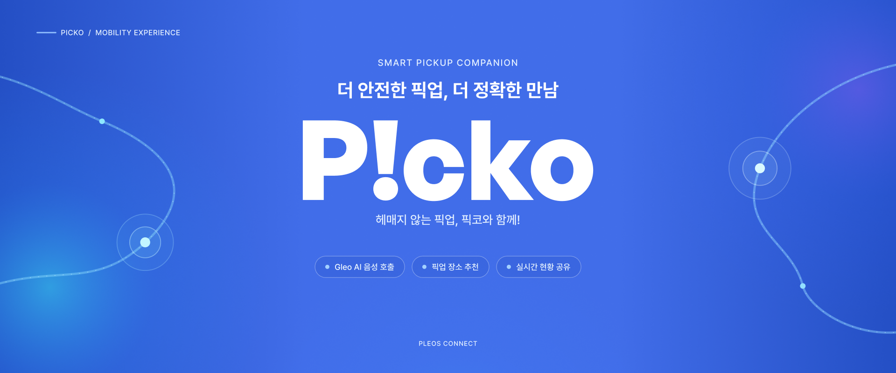
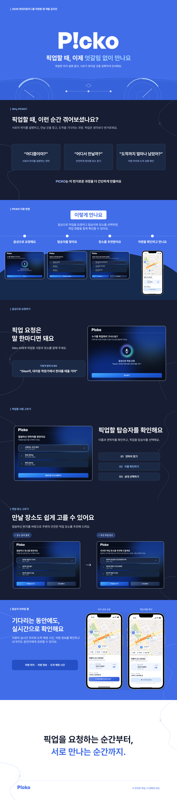
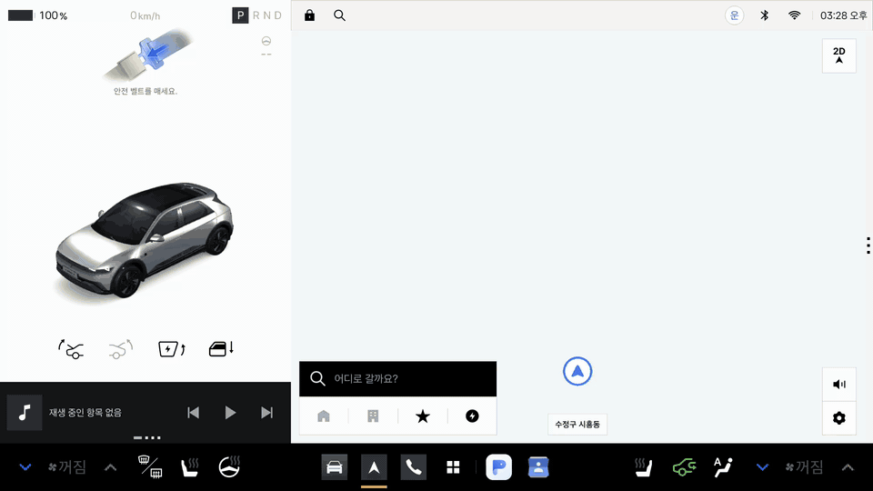

<div align="center">

<br>



<br><br>

### “어디야?” 대신 “픽코 불러줘!”

**운전자와 탑승자가 가장 안전하게 만날 장소를 설계하는 차량 속 AI 픽업 에이전트**

<br>


&nbsp;

&nbsp;


<br><br>


<br>

</div>


---

##  01. Overview


### About PICKO

> **PICKO — “어디야?” 대신 “픽코 불러줘!”**

PICKO(픽코)는 차량 내 음성 호출로 픽업 장소를 추천하고, 모바일 웹을 통해 차량 위치와 도착 상황을 실시간으로 공유하는 **차량 특화 AI 픽업 에이전트**입니다.

운전자와 탑승자를 연결하여 더욱 안전하고 정확한 만남을 지원합니다.

<br>




---

##  02. Key Features

<table width="100%">
<tr>
<td width="50%" align="center">
<!--  -->
<br><strong>01. AI 음성 호출</strong><br><br>
<sub>차량 내 Gleo AI를 통한 픽업 요청 및 서비스 호출</sub><br><br>
</td>
<td width="50%" align="center">
<!--  -->
<br><strong>02. 스마트 픽업 장소 추천</strong><br><br>
<sub>차량 위치와 주변 도로 환경을 고려한 최적의 픽업 장소 추천</sub><br><br>
</td>
</tr>
<tr>
<td width="50%" align="center">
<!--  -->
<br><strong>03. 픽업 정보 공유</strong><br><br>
<sub>운전자와 탑승자를 연결하는 픽업 링크 생성 및 공유</sub><br><br>
</td>
<td width="50%" align="center">
<!--  -->
<br><strong>04. 실시간 위치 안내</strong><br><br>
<sub>모바일 웹을 통한 차량 위치 및 도착 상황 확인</sub><br><br>
</td>
</tr>
</table>

<br>

---

##  03. App Preview

<div align="center">

<!-- 제작한 README 포스터를 ./images/picko_poster.png 경로에 추가한 뒤 아래 주석을 해제하세요. -->
<!--  -->

GIF를 클릭하면 전체 시연 영상(mp4)으로 이동합니다.

<table width="100%">
<tr>
<td width="60%" align="center" valign="top">
<strong>Vehicle App Demo</strong><br><br>
<a href="./preview/vehicle/vehicle_demo.mp4"></a><br>
<sub>차량 앱 시연 (Pleos Connect Emulator)</sub>
</td>
<td width="40%" align="center" valign="top">
<strong>Passenger Web Demo</strong><br><br>
<a href="./preview/web/web_demo.mp4"></a><br>
<sub>탑승자 모바일 웹 시연</sub>
</td>
</tr>
</table>

</div>

<br>

---

##  04. Tech Stack

### Android / Vehicle

<table width="100%">
<thead><tr><th align="center">Category</th><th align="center">Stack</th></tr></thead>
<tbody>
<tr><td align="center"><strong>Language</strong></td><td align="center">Kotlin</td></tr>
<tr><td align="center"><strong>UI</strong></td><td align="center">Jetpack Compose</td></tr>
<tr><td align="center"><strong>Architecture / DI</strong></td><td align="center">Hilt</td></tr>
<tr><td align="center"><strong>AI / Vehicle</strong></td><td align="center">Pleos Gleo AI, NaviHelper</td></tr>
<tr><td align="center"><strong>Map</strong></td><td align="center">Kakao Map SDK</td></tr>
<tr><td align="center"><strong>Navigation</strong></td><td align="center">Kakao Mobility Directions API</td></tr>
<tr><td align="center"><strong>Location</strong></td><td align="center">FusedLocation</td></tr>
<tr><td align="center"><strong>Local Storage</strong></td><td align="center">DataStore Preferences</td></tr>
</tbody></table>

### Server

<table width="100%">
<thead><tr><th align="center">Category</th><th align="center">Stack</th></tr></thead>
<tbody>
<tr><td align="center"><strong>Language / Runtime</strong></td><td align="center">Java 17</td></tr>
<tr><td align="center"><strong>Framework</strong></td><td align="center">Spring Boot 3.3.5</td></tr>
<tr><td align="center"><strong>Build</strong></td><td align="center">Gradle Wrapper</td></tr>
<tr><td align="center"><strong>Database</strong></td><td align="center">H2 (dev), PostgreSQL (prod 전환 가능)</td></tr>
<tr><td align="center"><strong>Deployment</strong></td><td align="center">Railway, Dockerfile</td></tr>
<tr><td align="center"><strong>Integrations</strong></td><td align="center">Kakao Directions / Local POI, SOLAPI, OSRM Walking</td></tr>
</tbody></table>

### Passenger Web

<table width="100%">
<thead><tr><th align="center">Category</th><th align="center">Stack</th></tr></thead>
<tbody>
<tr><td align="center"><strong>Frontend</strong></td><td align="center">HTML, JavaScript, CSS (정적 파일)</td></tr>
<tr><td align="center"><strong>Map</strong></td><td align="center">Kakao Maps JavaScript SDK</td></tr>
<tr><td align="center"><strong>Typography</strong></td><td align="center">Pretendard (jsDelivr CDN)</td></tr>
<tr><td align="center"><strong>Build</strong></td><td align="center">별도 번들러 / Node.js 불필요</td></tr>
<tr><td align="center"><strong>Deployment</strong></td><td align="center">Server의 <code>src/main/resources/static/</code>에 포함</td></tr>
<tr><td align="center"><strong>Target</strong></td><td align="center">모바일 Safari / Chrome</td></tr>
</tbody></table>

<br>

---

##  05. Getting Started

### Android / Vehicle App

#### STEP 01. Development Environment

<table width="100%">
<thead><tr><th align="center">Environment</th><th align="center">Requirement</th></tr></thead>
<tbody>
<tr><td align="center"><strong>IDE</strong></td><td align="center">Android Studio 2026.2</td></tr>
<tr><td align="center"><strong>Language</strong></td><td align="center">Kotlin 2.2.10</td></tr>
<tr><td align="center"><strong>JDK</strong></td><td align="center">25 (Android Studio 내장 JBR)</td></tr>
<tr><td align="center"><strong>Android Gradle Plugin</strong></td><td align="center">9.4.1</td></tr>
<tr><td align="center"><strong>Gradle</strong></td><td align="center">9.6.0</td></tr>
<tr><td align="center"><strong>SDK</strong></td><td align="center"><code>compileSdk 37</code>, <code>minSdk 28</code>, <code>targetSdk 34</code></td></tr>
<tr><td align="center"><strong>Vehicle Emulator</strong></td><td align="center">Pleos Connect Emulator v2.1.0, Android 14 / API 34</td></tr>
</tbody></table>

#### STEP 02. Clone & Run

1. Android 저장소를 Clone한 후 Android Studio에서 프로젝트를 열고 Gradle Sync를 진행합니다.
2. Pleos Connect Emulator AVD를 생성하고 **Cold boot**로 실행합니다. 시스템 이미지는 `android-34/pleos_car_emulator` (`arm64-v8a`)입니다.
3. `local.properties`에 필요한 설정값을 입력하고 `app`을 실행합니다. 명령줄에서는 아래 명령어를 사용합니다.
4. Gleo 음성 호출 기능을 사용하려면 앱 설치 후 에뮬레이터를 한 번 재부팅합니다. Gleo가 부팅 시 `schema.json`을 읽기 때문입니다.

**설치 가이드:** [Pleos Connect Emulator](https://document.pleos.ai/docs/connect/guide/getting-started/application-development/setup-connect-sdk-emulator)

```bash
./gradlew installDebug
```

#### STEP 03. Configuration

`local.properties`는 저장소에 커밋하지 않습니다. 아래 표는 **키 이름과 용도만** 안내합니다.

<table width="100%">
<thead><tr><th align="center">Key</th><th align="center">Purpose</th><th align="center">미설정 시</th></tr></thead>
<tbody>
<tr><td align="center"><code>base.url</code></td><td align="center">PICKO 서버 주소 (<code>https://picko.up.railway.app/</code>)</td><td align="center">서버 연동 불가</td></tr>
<tr><td align="center"><code>kakao.native.key</code></td><td align="center">Kakao Map SDK 네이티브 앱 키</td><td align="center">지도 인증 실패</td></tr>
<tr><td align="center"><code>kakao.platform.key</code></td><td align="center">Kakao REST 키: 자동차 길찾기 및 장소 검색</td><td align="center">길찾기를 건너뛰고 가짜 경로 사용</td></tr>
<tr><td align="center"><code>demo.drive=true</code></td><td align="center">빌드 종류와 무관하게 시연 차량이 지정 좌표를 따라 이동 (<code>-Pdemo.drive=true</code>로도 지정)</td><td align="center">시연 주행 비활성화</td></tr>
</tbody></table>

Pleos STT·TTS는 온디바이스 모드로 사용하므로 Pleos 클라이언트 ID와 시크릿이 필요하지 않습니다.

> **실행 시 유의사항**  
> 카카오 지도·길찾기에는 등록된 서명 키 해시와 API 키가 필요합니다. 소스를 직접 빌드하면 일부 기능이 동작하지 않을 수 있으며, 필요 시 심사자의 서명 키 해시를 추가 등록해야 합니다. 정상 동작 확인은 `apk/OffCourse_Picko_release.apk`를 Pleos Connect Emulator에 설치하여 진행합니다.

#### STEP 04. Build & Test

```bash
./gradlew assembleDebug
./gradlew testDebugUnitTest
./gradlew lintDebug
```

### Server

#### Development Environment

<table width="100%">
<thead><tr><th align="center">Environment</th><th align="center">Requirement</th></tr></thead>
<tbody>
<tr><td align="center"><strong>JDK</strong></td><td align="center">Java 17 (Temurin 권장)</td></tr>
<tr><td align="center"><strong>IDE</strong></td><td align="center">IntelliJ IDEA</td></tr>
<tr><td align="center"><strong>Spring Boot</strong></td><td align="center">3.3.5</td></tr>
<tr><td align="center"><strong>Gradle</strong></td><td align="center">Wrapper 포함, 별도 설치 불필요</td></tr>
<tr><td align="center"><strong>DB</strong></td><td align="center">H2 인메모리 (dev) / PostgreSQL (prod 전환 가능)</td></tr>
<tr><td align="center"><strong>OS</strong></td><td align="center">macOS / Linux 검증, Windows는 <code>gradlew.bat</code> 사용</td></tr>
</tbody></table>

#### Configuration

`application.yml` 설정은 환경변수로 재정의할 수 있습니다. 키가 없으면 일부 기능이 데모 키 또는 SMS Mock 모드로 동작합니다.

<table width="100%">
<thead><tr><th align="center">Variable</th><th align="center">Required</th><th align="center">Purpose / Behavior</th></tr></thead>
<tbody>
<tr><td align="center"><code>KAKAO_REST_API_KEY</code></td><td align="center">◯</td><td align="center">Kakao Directions / Local POI. 미설정 시 공유 데모 키 fallback</td></tr>
<tr><td align="center"><code>SOLAPI_API_KEY</code></td><td align="center">△</td><td align="center">SMS 발송. 미설정 시 Mock 모드 (실제 발송 없음)</td></tr>
<tr><td align="center"><code>SOLAPI_API_SECRET</code></td><td align="center">△</td><td align="center">SOLAPI 인증 시크릿. 미설정 시 Mock 모드</td></tr>
<tr><td align="center"><code>SOLAPI_SENDER_PHONE</code></td><td align="center">△</td><td align="center">SOLAPI 콘솔에 등록된 발신 번호</td></tr>
<tr><td align="center"><code>OSRM_WALKING_URL</code></td><td align="center">✕</td><td align="center">보행 라우팅. 기본 <code>https://routing.openstreetmap.de/routed-foot</code></td></tr>
<tr><td align="center"><code>PORT</code></td><td align="center">✕</td><td align="center">서버 포트. 기본 <code>5173</code>, Railway 자동 주입</td></tr>
</tbody></table>

### Passenger Web

#### Development Environment

- 순수 정적 파일: `index.html`, `app.js`, `style.css`, `assets/`
- 별도의 Node.js, npm, 빌드 도구 또는 번들러 불필요
- 외부 의존성: Kakao Maps JavaScript SDK, Pretendard (jsDelivr CDN)
- 대상 브라우저: 모바일 Safari / Chrome

#### Access

- SMS로 받은 링크를 열면 웹에 접속됩니다.
- 배포 시 웹 정적 파일 사본은 `picko-server/src/main/resources/static/`에서 제공됩니다.

> **접속 시 유의사항**  
> 링크는 발급될 때마다 새로 만들어지며, 링크 하나에는 한 명의 사용자만 접근할 수 있습니다. 사용자는 브라우저 쿠키로 식별되므로, 링크를 처음 연 브라우저가 아닌 다른 브라우저나 기기에서 같은 링크를 열면 접근할 수 없습니다.

#### Configuration

<table width="100%">
<thead><tr><th align="center">Item</th><th align="center">Location / Notes</th></tr></thead>
<tbody>
<tr><td align="center"><strong>Kakao Maps JS Key</strong></td><td align="center"><code>index.html</code>의 SDK 스크립트. Kakao Developers 콘솔에 사용 도메인 등록 필요</td></tr>
<tr><td align="center"><strong>OG Image URL</strong></td><td align="center"><code>index.html</code>의 <code>og:image</code>. 배포 도메인 변경 시 수정</td></tr>
<tr><td align="center"><strong>Server Endpoint</strong></td><td align="center"><code>app.js</code>의 세션 / WebSocket 호출. 동일 오리진의 <code>/api/...</code>, <code>/ws/...</code> 상대 경로 사용</td></tr>
</tbody></table>

<br>

---

##  06. Test Environment

### Android / Vehicle App

#### Devices & OS

<table width="100%">
<thead><tr><th align="center">Item</th><th align="center">Environment</th></tr></thead>
<tbody>
<tr><td align="center"><strong>Vehicle</strong></td><td align="center">Pleos Connect Emulator v2.1.0 (AAOS 기반, Android 14 / API 34, <code>arm64-v8a</code>)</td></tr>
<tr><td align="center"><strong>Display</strong></td><td align="center">2560 × 1440 px, 160 dpi (가로 방향, 약 1600 × 900 dp), RAM 4 GB</td></tr>
<tr><td align="center"><strong>Phone (Auxiliary)</strong></td><td align="center">Pixel 10 Pro AVD (API 37, 1280 × 2856, 480 dpi) — 블루투스 연락처·문자 확인용</td></tr>
<tr><td align="center"><strong>Real Vehicle</strong></td><td align="center">확인 전</td></tr>
</tbody></table>

#### Test Setup

차량 에뮬레이터와 휴대폰 AVD를 함께 실행하고 가상 블루투스로 페어링합니다. 연락처(PBAP) 및 문자(MAP) 연동을 확인하려면 휴대폰에서 연락처·메시지 접근을 허용합니다.

**시연 주행:** 실제 차량 주행 검증은 별도로 필요합니다. 제출용 Release 앱에서는 `demo.drive=true`로 지정된 좌표를 따라 차량이 움직이는 모습을 확인할 수 있습니다. 차량 도착 시간은 차량 주행 속도를 기준으로 계산되며, 시연 환경의 차량 속도는 **40 m/s**, 탑승자 웹의 계산 기준은 **400 m/분**이므로 양쪽의 표시 도착 시간이 다를 수 있습니다.

#### Required Permissions

<table width="100%">
<thead><tr><th align="center">Permission</th><th align="center">Purpose</th><th align="center">Notes</th></tr></thead>
<tbody>
<tr><td align="center"><code>INTERNET</code></td><td align="center">지도 타일 및 서버 통신</td><td align="center"></td></tr>
<tr><td align="center"><code>READ_CONTACTS</code></td><td align="center">탑승자 이름으로 전화번호 조회</td><td align="center">런타임 허용</td></tr>
<tr><td align="center"><code>pleos.car.permission.FUSED_LOCATION</code></td><td align="center">차량 위치</td><td align="center">런타임 허용 필요</td></tr>
<tr><td align="center"><code>pleos.car.permission.STT_SERVICE</code></td><td align="center">음성 인식</td><td align="center"></td></tr>
<tr><td align="center"><code>pleos.car.permission.TTS_SERVICE</code></td><td align="center">음성 안내</td><td align="center"></td></tr>
<tr><td align="center"><code>pleos.car.permission.NAVI_ROUTE</code></td><td align="center">내비 소요 시간 조회 (<code>requestTrip</code>)</td><td align="center"></td></tr>
<tr><td align="center"><code>pleos.car.permission.NAVI_ROUTE_SEARCH</code></td><td align="center">경로 탐색·안내 요청 (<code>requestRoute</code>)</td><td align="center">현재 호출하는 곳 없음</td></tr>
<tr><td align="center"><code>pleos.car.permission.NAVI_CUSTOM_MAP</code></td><td align="center">내비 화면 표시 (<code>requestNavigationScreen</code>, 목적지 안내하기)</td><td align="center"></td></tr>
</tbody></table>

`MainActivity`에는 `distractionOptimized` 메타데이터가 선언되어 있어 주행 중에도 앱이 열립니다.

### Server

<table width="100%">
<thead><tr><th align="center">Item</th><th align="center">Environment</th></tr></thead>
<tbody>
<tr><td align="center"><strong>Runtime</strong></td><td align="center">Java 17 (Temurin 권장)</td></tr>
<tr><td align="center"><strong>Framework</strong></td><td align="center">Spring Boot 3.3.5</td></tr>
<tr><td align="center"><strong>Build</strong></td><td align="center">Gradle Wrapper</td></tr>
<tr><td align="center"><strong>DB</strong></td><td align="center">H2 인메모리 (dev), PostgreSQL (prod 전환 가능)</td></tr>
<tr><td align="center"><strong>Deployment</strong></td><td align="center">Railway, Dockerfile 기반 자동 배포</td></tr>
<tr><td align="center"><strong>Port</strong></td><td align="center">기본 <code>5173</code>, 환경변수 <code>PORT</code>로 변경 가능</td></tr>
</tbody></table>

- H2 인메모리 세션 저장소는 서버 재시작 시 세션과 토큰이 초기화됩니다.
- 필수 환경변수 및 API 키 설정은 **05. Getting Started → Server**의 표를 참조합니다.

### Passenger Web

<table width="100%">
<thead><tr><th align="center">Item</th><th align="center">Environment</th></tr></thead>
<tbody>
<tr><td align="center"><strong>Files</strong></td><td align="center"><code>index.html</code>, <code>app.js</code>, <code>style.css</code>, <code>assets/</code></td></tr>
<tr><td align="center"><strong>Build</strong></td><td align="center">별도 빌드 도구 불필요</td></tr>
<tr><td align="center"><strong>Dependencies</strong></td><td align="center">Kakao Maps JavaScript SDK, Pretendard (jsDelivr CDN)</td></tr>
<tr><td align="center"><strong>Browsers</strong></td><td align="center">모바일 Safari / Chrome</td></tr>
<tr><td align="center"><strong>Deployment</strong></td><td align="center">서버의 <code>src/main/resources/static/</code>에서 제공</td></tr>
</tbody></table>

- SMS로 받은 링크를 열면 웹에 접속됩니다.
- 세션 토큰 없이 접근하면 **링크 만료** 화면이 표시됩니다.
- 링크 하나에는 한 명의 사용자만 접근할 수 있습니다. 사용자는 브라우저 쿠키로 식별되므로, 링크를 처음 연 브라우저가 아닌 다른 브라우저나 기기에서는 접근할 수 없습니다.
- Kakao Maps JS 키, OG 이미지 URL, 서버 엔드포인트 설정은 **05. Getting Started → Passenger Web**의 표를 참조합니다.

<br>

---

##  07. APK & Release

<div align="center">

### Download PICKO

<a href="https://github.com/smsdia/Picko/raw/main/apk/OffCourse_Picko_release.apk">

</a>
&nbsp;
<a href="https://github.com/smsdia/Picko/tree/main/apk">

</a>

</div>

<br>

<table width="100%">

<thead><tr><th align="center">Item</th><th align="center">Details</th></tr></thead>

<tbody>

<tr><td align="center"><strong>Version</strong></td><td align="center"><code>1.0</code></td></tr>

<tr><td align="center"><strong>APK</strong></td><td align="center"><a href="https://github.com/smsdia/Picko/raw/main/apk/OffCourse_Picko_release.apk"><code>OffCourse_Picko_release.apk</code></a></td></tr>

<tr><td align="center"><strong>APK Directory</strong></td><td align="center"><a href="https://github.com/smsdia/Picko/tree/main/apk"><code>main/apk</code></a></td></tr>

<tr><td align="center"><strong>Alternative Raw URL</strong></td><td align="center"><a href="https://raw.githubusercontent.com/smsdia/Picko/main/apk/OffCourse_Picko_release.apk">Raw APK</a></td></tr>

</tbody></table>


<br>

---

##  08. Resources

<table width="100%">
<thead><tr><th align="center">Resource</th><th align="center">Link</th></tr></thead>
<tbody>
<tr><td align="center"><strong>Android Repository</strong></td><td align="center"><a href="https://github.com/smsdia/Picko">Picko</a></td></tr>
<tr><td align="center"><strong>Web Repository</strong></td><td align="center"><a href="https://github.com/YamBlah/Picko-web">Picko-web</a></td></tr>
<tr><td align="center"><strong>Server Repository</strong></td><td align="center"><a href="https://github.com/YamBlah/Picko-server">Picko-server</a></td></tr>
<tr><td align="center"><strong>Figma — UI 디자인 및 프로토타입</strong></td><td align="center"><a href="https://www.figma.com/design/JPMWETJfQWTImjbH2okdNz/-현대자동차그룹--차량용-앱-개발-공모전?node-id=0-1">View Figma</a></td></tr>
<tr><td align="center"><strong>Demo Videos</strong></td><td align="center"><a href="./preview/vehicle/vehicle_demo.mp4">Vehicle App</a> · <a href="./preview/web/web_demo.mp4">Passenger Web</a></td></tr>
</tbody></table>

<br>

---

<div align="center">

<sub>© 2026 OffCourse</sub>

</div>